# 科研小助手 Agent（Research Copilot）

面向科研文献工作流的本地优先 Agent 系统：**PDF 细粒度解析 → 语义去重与版本比对 → 抗幻觉 RAG 问答 → 中英对照翻译 → 引用图谱与前沿挖掘 → 论文写作 Copilot**，六模块由 Agent 统一编排。

Lite 版零外部依赖即可启动（无 API Key 自动降级离线模式），配置 DeepSeek 后全部模块切换为 LLM 模式。

---

## 1. 功能一览

| 模块 | 能力 | 关键实现 |
|---|---|---|
| PDF 解析 | 双栏还原、字号聚类标题、表格转 MD、公式与图注抽取、参考文献识别 | PyMuPDF + 版面规则，解析结果缓存 |
| 语义去重 | 同一论文不同版本的自动归并与差异比对 | 64-permutation MinHash + shingle(5)，`DUP_THRESHOLD=0.45`，arXiv 底号强关联 |
| 抗幻觉 RAG | 检索 → 证据约束作答 → 引用校验 | BM25 + 稠密向量 + RRF；低置信拒答；生成后剔除无依据引用 |
| 翻译 | 全文/段落翻译，中英对照阅读 | 公式、代码块、URL、`[12]` 引用做占位符保护 |
| 引用图谱 | PageRank 分层（bedrock / frontier / normal）、Future Work 状态判定 | NetworkX DiGraph + 关键词重合度 |
| 学术写作 Copilot | 大纲、图表代码、CSV→图表、综述段落 | 证据驱动生成，输出附参考文献 |
| Agent | 规划 → 工具调用 → 观察 → 汇总（SSE 流式） | 16 个工具，最多 6 步，JSON function calling；按「工具+关键参数」语义去重；每次执行落库，可回放 trace |
| 图表理解 | 「图 N 展示了什么」定位图注、裁剪原图、OCR 图内文字并作答 | 图注正则定位 + PyMuPDF 区域渲染 + PaddleOCR，问答页与 Agent `figure_lookup` 双入口 |
| 长文档分层检索 | 章节级粗索引 → 块级下钻 → 与全局检索 RRF 合并 | 百页长文 recall@1 0.80（全局 hybrid 0.75），问答页可开关 |
| 版本比对 | 同一 arXiv 系列两版的差异 | 正文重合度 + 章节增删 + 可选 LLM 多维对比，独立 `/compare` 页 |
| 元数据补全 | 上传后自动补全题录 | 后台线程调 arXiv metadata 补 title/authors/year/abstract，失败降级不阻塞上传 |
| 论文检索 | arXiv / Semantic Scholar 双源关键词检索与一键入库 | 双源合并去重、S2 限流退避 + 结果缓存，单源失败不拖垮另一源 |

前端 7 个页面：文库 / 问答 / 阅读器（含划词翻译、证据 bbox 高亮）/ 图谱（力导向交互）/ 写作 Copilot / Agent（执行 + 历史）/ 版本比对。
统一空态 / 错误态 / 骨架屏组件（`web/components/State.tsx`）；≤768px 移动端适配：导航横向滑动、卡片单列、图谱画布横向拖看、划词浮层宽度自适应。

---

## 2. 目录结构

```
research-copilot/
├── backend/
│   ├── app/
│   │   ├── api/            # papers.py / chat.py（问答、比对、Agent 执行历史）
│   │   ├── services/       # pdf_parser, dedup, store, rag, translate, graph, copilot, agent, arxiv, scholar, figures, insights, codeexec, enrich, llm, embeddings
│   │   ├── main.py         # FastAPI 入口（app.main:app）
│   │   ├── db.py           # SQLite（WAL，无 ORM）
│   │   └── settings.py     # 环境变量
│   ├── scripts/            # fetch_papers.py / bench_agent.py / bench_retrieval.py / demo_e2e.py
│   ├── tests/              # pytest，隔离临时库
│   ├── requirements.txt
│   └── .env.example
├── web/                    # Next.js 14 App Router + TypeScript
│   ├── app/                # page.tsx / chat / reader / graph / copilot / agent / compare
│   └── components/         # State.tsx（统一空态 / 错误态 / 骨架屏）
├── data/                   # SQLite 与 PDF（Docker 时挂载到 /app/data）
├── docker-compose.yml
├── Dockerfile.backend
├── Dockerfile.web
├── AGENT_BENCHMARK.md      # Agent 评测报告
└── 演示脚本_10分钟分镜.md
```

---

## 3. 快速开始

### 3.1 Docker（推荐，已实测）

```bash
cd research-copilot
docker compose build          # 首次约 3–5 分钟
docker compose up -d
docker compose ps             # backend 应为 Up (healthy)
```

打开 <http://localhost:3000>。

> 国内网络需先给 Docker 配镜像加速（`~/.docker/daemon.json` 的 `registry-mirrors`），否则拉基础镜像会卡住。
> 后端镜像默认用阿里云 PyPI 镜像装依赖，可加 `--build-arg PIP_INDEX_URL=...` 覆盖。
> 中文 OCR 模型（PP-OCRv6 det + rec）已预下载并烘进后端镜像，**断网也能识别扫描件**，无需额外挂卷。
> 详细步骤与排错见 `PyCharm一站式操作手册.md` 第 6.5 节。

### 3.2 本地启动（不用 Docker）

前置：Python 3.10、Node 18+。

```bash
# 后端
cd backend
python -m pip install -r requirements.txt
copy .env.example .env          # 填入 LLM_API_KEY（可留空，自动离线模式）
python -m uvicorn app.main:app --host 0.0.0.0 --port 8000 --reload

# 前端（另开一个终端）
cd web
npm install
npm run dev
```

Windows 可直接双击 `启动.bat` 与 `启动前端.bat`。

> 注意：后端必须在 `backend` 目录下以 `app.main:app` 启动；在 `backend` 里新建 `main.py` 再跑 `uvicorn main:app` 只会得到一个空壳服务。

---

## 4. 配置项（`backend/.env`）

| 变量 | 说明 | 默认 |
|---|---|---|
| `LLM_BASE_URL` | OpenAI 兼容网关 | `https://api.deepseek.com/v1` |
| `LLM_API_KEY` | 留空则离线模式 | 空 |
| `LLM_MODEL` | 模型名 | `deepseek-chat` |
| `EMBEDDING_PROVIDER` | `hash`（零依赖）或 `http` | `hash` |
| `DATA_DIR` / `DB_PATH` | 数据目录 / 数据库路径 | `./data` |
| `DUP_THRESHOLD` | 去重阈值 | `0.45` |
| `RETRIEVE_TOP_K` | 检索条数 | `8` |
| `OCR_ENABLED` / `OCR_LANG` | 扫描件 OCR | `1` / `ch` |
| `S2_API_KEY` | Semantic Scholar Graph API 提额（可空） | 空 |

Docker 运行时，`docker-compose.yml` 会把 `DATA_DIR=/app/data`、`DB_PATH=/app/data/app.db` 覆盖进容器，避免读到宿主机的绝对路径。

---

## 5. 主要 API

| 方法 | 路径 | 说明 |
|---|---|---|
| GET | `/api/health` | 健康检查，返回 `llm` / `embedding` 状态 |
| GET/POST | `/api/papers` | 论文列表 / 上传 PDF（自动解析、去重、建索引） |
| GET | `/api/papers/discover?source=arxiv\|s2\|both` | arXiv / Semantic Scholar 双源在线检索 |
| POST | `/api/papers/fetch-arxiv` | 按 arXiv id 下载 PDF 并入库（`exists` / `duplicate` / `ok` 三种状态） |
| DELETE | `/api/papers/{id}` | 删除论文及其切片、引用 |
| GET | `/api/papers/{id}/chunks` | 阅读器分页切片（含 bbox） |
| POST | `/api/chat` | RAG 问答（返回 sources / 置信度 / mode；`hierarchical=true` 走长文档分层检索；问「图 N」自动走图表理解通道） |
| GET | `/api/figures/{paper_id}/{n}?q=` | 定位第 N 张图：图注 + 裁剪原图 + 图内 OCR 文字 |
| GET | `/api/figures/img/{name}` | 图表裁剪产物（文件名白名单校验） |
| POST | `/api/compare` | 多论文多维度对比 |
| GET | `/api/graph` | 引用图谱 + PageRank 分层（结果版本化缓存，返回 `cached`） |
| GET | `/api/future` | Future Work 抽取与 open/resolved 判定 |
| POST | `/api/translate` | 段落 / 整篇翻译 |
| POST | `/api/copilot/{outline,diagram,csv}` | 大纲 / 图表 / CSV 转图表 |
| POST | `/api/code/run` | 受限 Python 沙箱执行（返回 stdout / 图片产物） |
| GET | `/api/code/artifact/{name}` | 读取沙箱产出的图片 |
| GET | `/api/insights/reproducibility?paper_id=` | GitHub 仓库复现性评分（stars / License / 维护状态） |
| GET | `/api/insights/recommend?paper_id=&top_k=5` | 按标题+摘要相似度推荐库内相关论文 |
| POST | `/api/agent/run` | Agent SSE 流：`start → plan → step_start → tool_result → token → final` |
| GET | `/api/agent/runs?limit=30` | 执行历史列表（状态 / 耗时 / 摘要） |
| GET/DELETE | `/api/agent/runs/{run_id}` | 回放单次 trace 与最终答案 / 删除记录 |
| POST | `/api/compare/version-diff` | 两版正文重合度 + 章节增删 + 差异摘要 |

---

## 6. 评测

Agent 基准测试（10 个固定任务，真实调用 DeepSeek）：**成功率 10/10，平均 1.4 步，平均 23.7 秒，8/10 任务带页码引用**。

```bash
cd backend
python scripts/bench_agent.py
```

完整环境、逐任务明细与局限见 [AGENT_BENCHMARK.md](AGENT_BENCHMARK.md)。

检索质量基准（`backend/scripts/bench_retrieval.py`，BEIR 风格 qrels，可换公开数据集）在演示库 20 条冒烟查询上实测：

| 模式 | Recall@1 | Recall@5 | Recall@10 | MRR@10 |
|---|---|---|---|---|
| hybrid（BM25+向量+RRF） | 0.75 | 0.95 | 1.00 | 0.833 |
| hierarchical（长文档分层） | **0.80** | 0.95 | 1.00 | **0.867** |

```bash
docker exec research-copilot-backend python /app/scripts/bench_retrieval.py --mode hierarchical
# 自定义评测集：--qrels your_qrels.jsonl（每行 {"qid","query","relevant_papers":[...]}）
```

### 6.1 OCR 扫描件实测

把 FlashAttention 前 2 页渲染为纯图片 PDF（无文本层）模拟扫描件，上传后：

- `page_flags`：第 1、2 页均为 `ocr`（PaddleOCR 3.x，`enable_mkldnn=False` 规避 oneDNN 崩溃）；
- 切片：2 个，`kind` 全部为 `ocr`，页码正确；
- 基于该论文提问：`mode=llm`，答案与引用均来自 OCR 文本。

> PaddleOCR 模型已固化在后端镜像中，断网可直接识别；库内无模型且离线时降级为 `needs_ocr`，阅读器给出「扫描页未识别」提示。

---

## 6.2 定期抓取最新论文

赛题要求的「长时间自主科研监控」通过**计划任务 + 已有入库管线**实现，无需常驻进程：

```bash
# 抓最近 7 天投稿的 RAG 论文（按投稿时间倒序，日期过滤后入库）
docker exec research-copilot-backend python /app/scripts/fetch_papers.py \
    --query "retrieval augmented generation" --days 7 --limit 10
```

Windows 一键注册每日任务（默认每天 09:00）：

```powershell
powershell -ExecutionPolicy Bypass -File scripts\setup_schedule.ps1 `
    -Query "retrieval augmented generation" -Days 7 -Limit 10 -Time 09:00
# 立即跑一次：Start-ScheduledTask -TaskName research-copilot-fetch-arxiv
# 取消：Unregister-ScheduledTask -TaskName research-copilot-fetch-arxiv -Confirm:$false
```

Linux/macOS 用 cron 等价实现：

```cron
0 9 * * * docker exec research-copilot-backend python /app/scripts/fetch_papers.py --query "retrieval augmented generation" --days 7 --limit 10
```

已入库的论文按 arXiv 底号判重，重复抓取不会产生副本；抓取的新论文自动进入检索、图谱与问答范围。

---

## 6.3 代码执行沙箱

Agent 内置 `run_python` 工具，可在隔离环境中做数据处理与绘图（`pandas` / `numpy` / `scipy` / `matplotlib`）：

- 独立临时工作目录，工作目录预置 `papers.json`（库内题录：`id/title/year/num_pages`）
- 20 秒超时、环境变量白名单（不传递任何 API Key）、`-I` 隔离模式
- AST 静态检查拦截危险模块/调用/逃逸链属性（`__mro__`/`__globals__` 等），POSIX 下另加 `setsid` + CPU 30s / 地址空间 3GB 资源限制（兼容 numpy/pandas 正常导入）
- 生成的图片由系统回收，在 Agent 页面「工具返回」里直接预览

直接调用：

```bash
curl -X POST http://localhost:8000/api/code/run \
  -H "content-type: application/json" \
  -d '{"code":"import numpy as np, matplotlib.pyplot as plt\nplt.bar([1,2,3],[3,1,2])\nplt.savefig(\"c.png\")"}'
# → {"ok":true,"stdout":"","images":[{"name":"c.png","url":"/api/code/artifact/xxxx_c.png"}]}
```

---

## 6.4 GitHub 复现性评估与相关推荐

阅读器页面的「🔬 学术洞察」卡片自动给出两项信息，Agent 也可通过工具查询：

- **复现性评分（0–100）**：从摘要与正文中抽取 `github.com/owner/repo`，调用 GitHub API 拉取 stars / forks / License / 最近推送时间，按「存在仓库、社区规模、维护活跃度、License 明确」加权打分并给出结论。
- **相关论文推荐**：以标题+摘要为查询走 `hybrid_search`（`per_paper=1` 保证跨论文覆盖），聚合去重后返回 Top‑K，点击「阅读 →」直接跳转。

```bash
curl "http://localhost:8000/api/insights/reproducibility?paper_id=<id>"
# → {"score":100,"verdict":"找到 2 个可访问仓库；最高 25258 stars；近期仍在维护；含明确 License",...}

curl "http://localhost:8000/api/insights/recommend?paper_id=<id>&top_k=5"
# → {"items":[{"paper_id":"...","title":"...","score":0.31}, ...]}
```

GitHub API 结果缓存 600 秒；未配置网络或仓库无法访问时 `found=false`，评分相应下调，不影响页面其余部分渲染。

---

## 6.5 图表理解（多模态）

对「FlashAttention 论文的图 1 展示了什么？」这类问题，系统自动走图表理解通道（也可由 Agent `figure_lookup` 工具调用）：

1. 图注正则（`Figure N` / `图 N`）在解析期抽取的 figure/caption 块中定位目标图；
2. PyMuPDF 按 bbox 外扩裁剪，2× 渲染 PNG（经 `/api/figures/img/...` 提供，文件名白名单防目录穿越）；
3. PaddleOCR 识别图内文字（坐标轴、图例），与图注、同页正文一起作为作答唯一依据；
4. 问答页直接渲染裁剪原图 + 解释 + 图内识别文字，并附页码溯源。

PDF 路径按「原路径 → DATA_DIR 相对 → uploads 多模式回退」解析，容器与换机场景均可定位原文件。

## 6.6 Semantic Scholar 双源检索

`GET /api/papers/discover?source=arxiv|s2|both` 同时查询 arXiv 与 Semantic Scholar（Graph API），结果合并去重（arXiv id 优先），候选卡展示 S2 的被引数与 venue：

- S2 无 Key 共享配额有限，客户端做 5/15/30s 指数退避 + 300 秒结果缓存；可配 `S2_API_KEY` 提额；
- `source=both` 时单源失败只进 `partial_errors`，不拖垮另一源；
- 无 arXiv id 的 S2 结果暂不可一键入库（无公开 PDF 直链），在候选卡上明确标注。

---

## 7. 演示

10 分钟答辩分镜（准备清单、逐分钟脚本、3 个演示问题、评委问答）见 `演示脚本_10分钟分镜.md`，其中第八节是逐段录屏操作清单。

评分点与代码的对应关系（能力 → 页面 → 接口 → 代码 → 截图）见 [`docs/评分映射.md`](docs/评分映射.md)。

### 7.1 界面截图（演示库 22 篇）

| 文库（去重 + 扫描件标记） | 问答（证据溯源） |
|---|---|
| 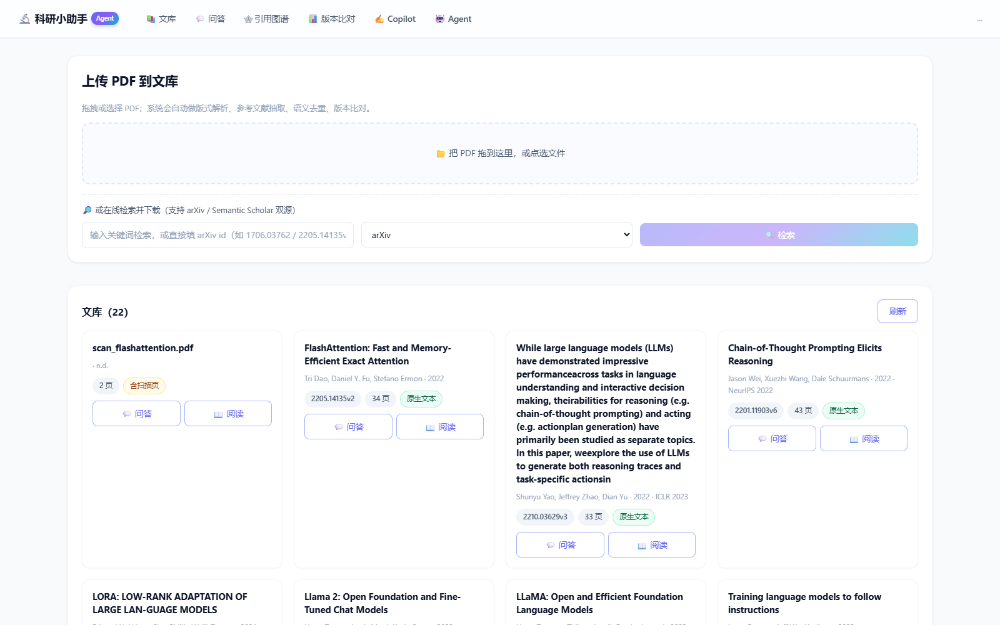 | 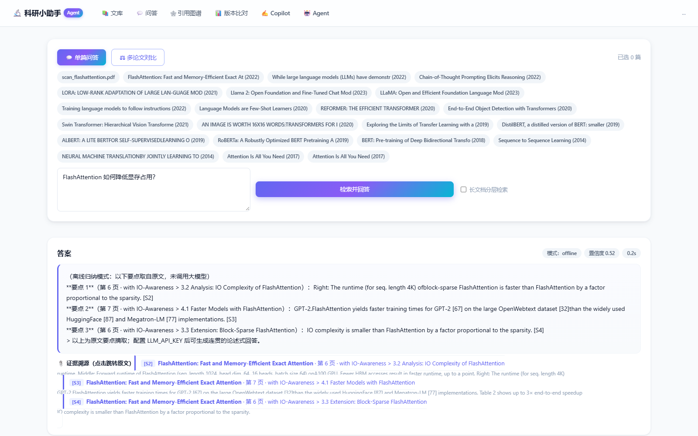 |

| 阅读器（页码 + 章节） | 引用图谱（PageRank 分层 + 版本虚线） |
|---|---|
| 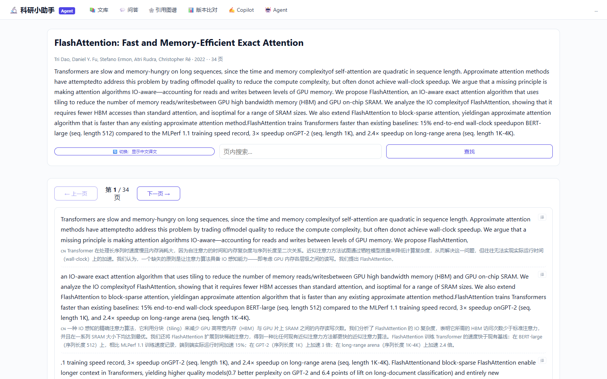 | 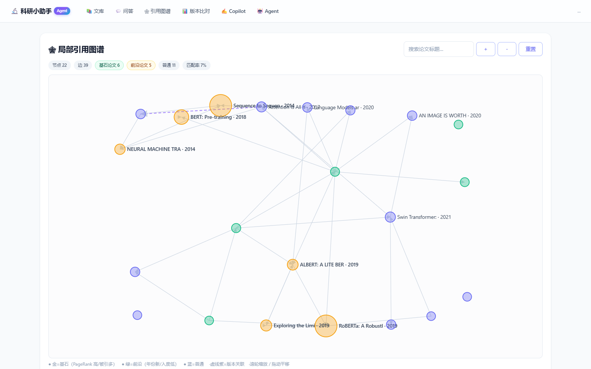 |

| 写作 Copilot | Agent（执行 + 历史） | 版本比对 |
|---|---|---|
| 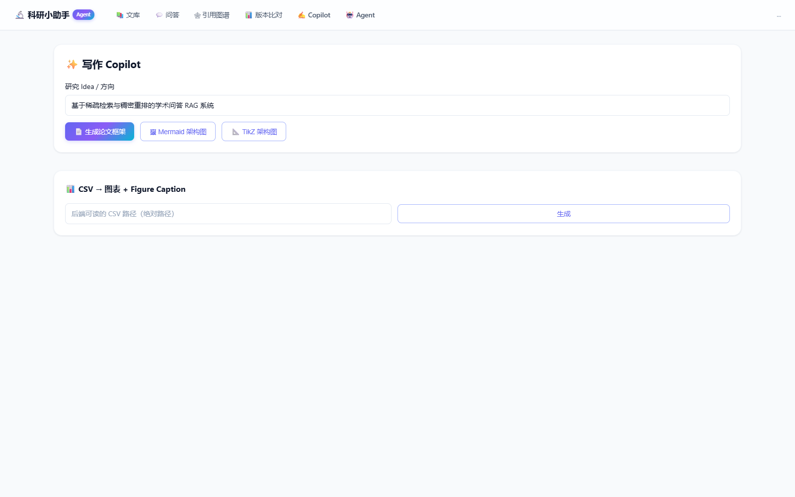 | 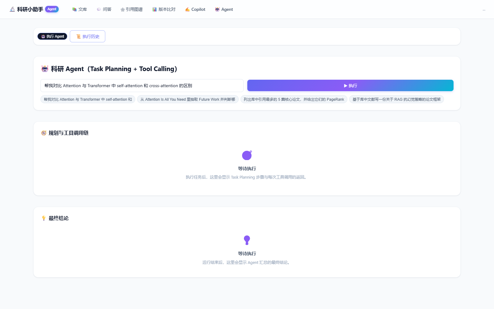 | 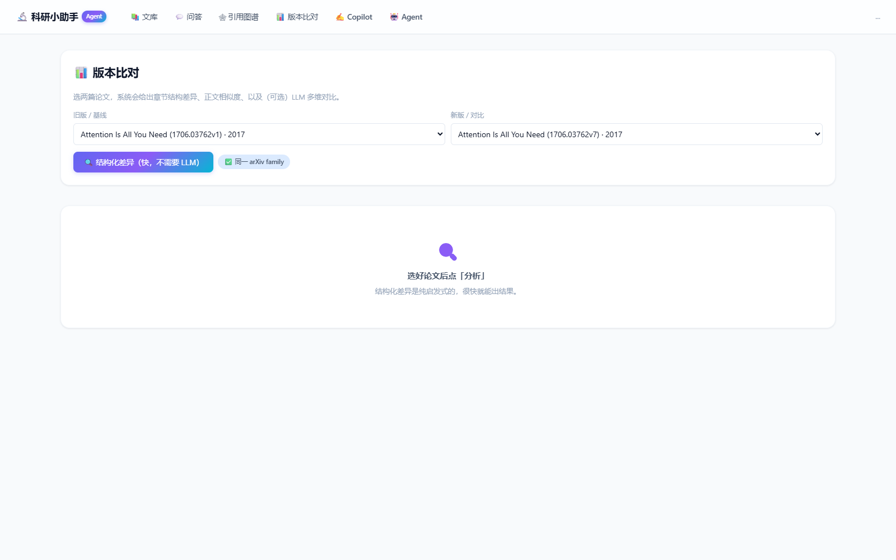 |

| 图表理解（图 N 问答 + 裁剪原图） | 移动端 390px | 双源检索（arXiv + S2） |
|---|---|---|
| 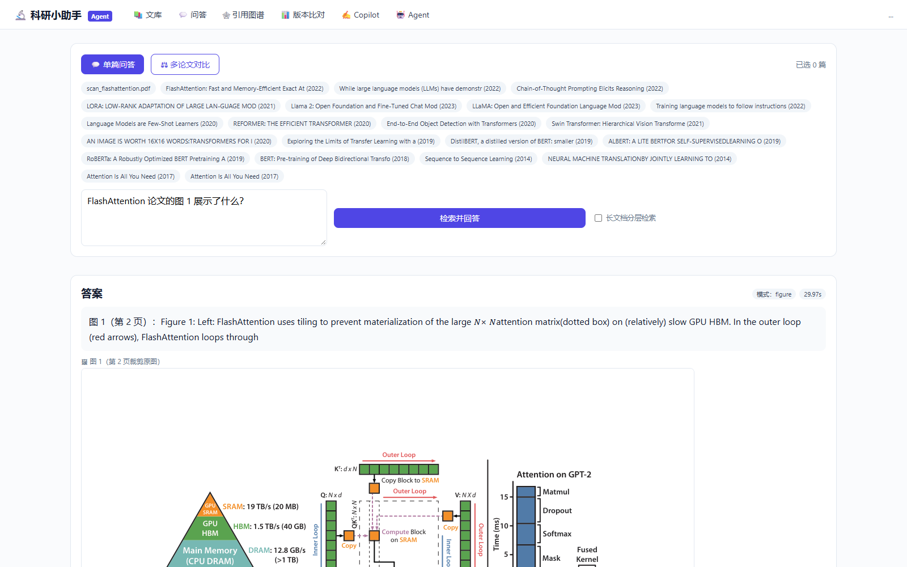 | 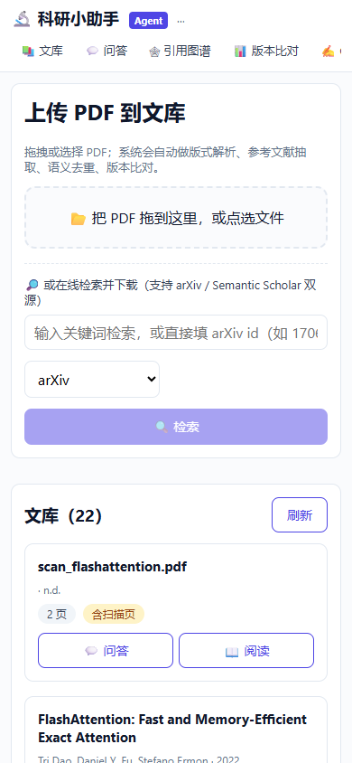 | 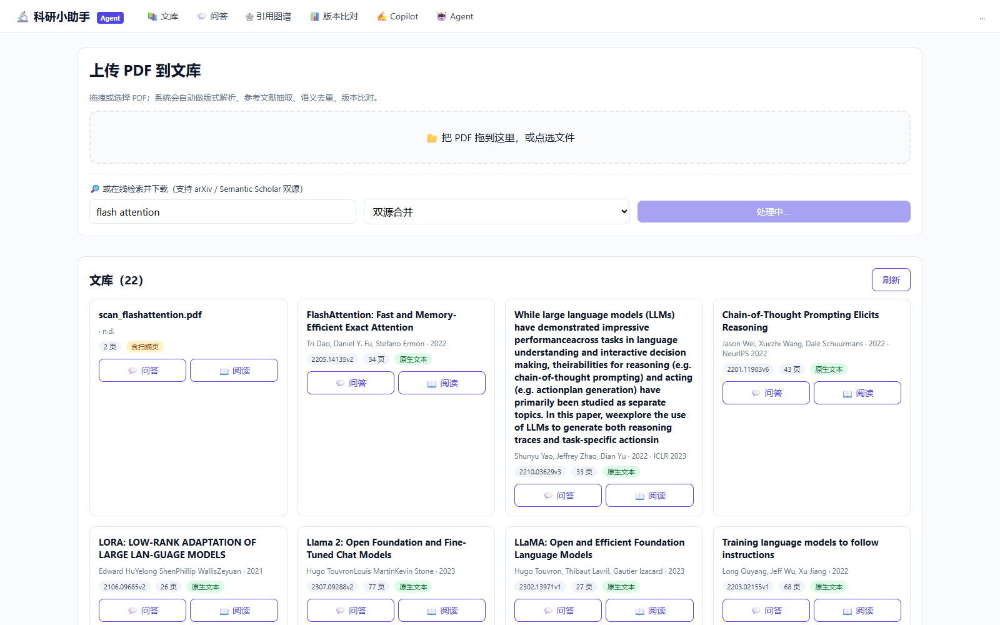 |

---

## 8. 已知局限

- OCR 对低质量 / 手写扫描件识别率有限；中文扫描件需设 `OCR_LANG=ch`。
- 图谱首次计算约 8–10 秒，结果按 `graph_version` 缓存进 SQLite（论文增删自动失效），命中后 < 0.5 秒。
- 演示库随包提供 22 篇（20 篇核心论文 + 1 份扫描件 + 1 组版本对），图谱写回缓存后二次打开 0.3 秒。
- 图表理解依赖解析期抽取的 figure/caption 块与图注编号；无编号图注的论文按出现顺序近似定位。
- Agent 评测集 10 条为自建小集，不等同公开 benchmark。
- 解析器对极少数双栏 PDF 会出现单词粘连（如 `otherstrategies`），可在阅读页手动核对原文。

---

## 9. 技术栈

后端 FastAPI / Uvicorn / PyMuPDF / NetworkX / SQLite（WAL）/ NumPy / pytest；
前端 Next.js 14 (App Router) / React 18 / TypeScript / 手写 SVG 力导向（不引 d3）；
模型 DeepSeek（OpenAI 兼容），Embedding 默认 384 维特征哈希。

---

## 10. 系统架构

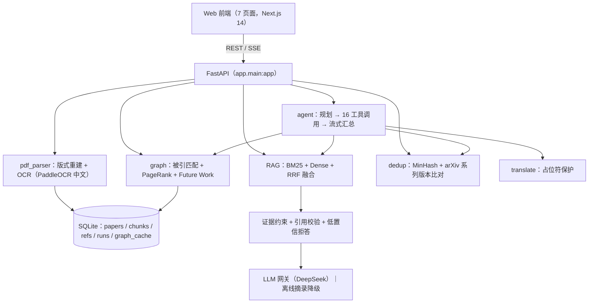

**降级链**：无 `LLM_API_KEY` → 抽取式问答；无向量 API → 384 维特征哈希；无 OCR 模型且离线 → `needs_ocr` 标记。

---

## 11. 评审包内容

| 项 | 内容 |
|---|---|
| repo | `backend/` + `web/` + Dockerfile + docker-compose + 测试与脚本 |
| 自主探索 | arXiv / Semantic Scholar 双源检索与一键入库、定期抓取最新投稿、Python 沙箱、GitHub 复现性与相关推荐、图表理解（README §6.2–6.6） |
| data | 演示库 `data/app.db`（22 篇：20 篇核心论文 + 1 份扫描件 + 1 组版本对，4918 切片 / 784 参考文献）+ `uploads/` PDF |
| README | 本文件（功能、启动、API、评测、架构图、局限） |
| 评测报告 | `AGENT_BENCHMARK.md`（10 任务成功率 10/10） |
| 评分映射 | `docs/评分映射.md`（能力 → 页面 → 接口 → 代码 → 截图，含实测指标与已知不足） |
| 答辩脚本 | `演示脚本_10分钟分镜.md`（含第八节逐段录屏操作清单） |
| 视频 | 待录制后补链接：`（视频链接占位）` |

冷启动：

```bash
docker compose up -d --build     # 首次构建较慢，之后秒级
```

中文 OCR 模型已内置镜像，断网可用；无 Key 时全部功能自动走离线降级，仍可完整演示。

---

## 12. 致谢

感谢全国高校 AI 大模型挑战赛提供的赛题与评审机会；感谢 DeepSeek 提供 OpenAI 兼容推理网关；本项目解析、检索、图谱、Agent 编排均为手写实现，参考了 PyMuPDF、NetworkX、PaddleOCR、Next.js 的公开文档。
